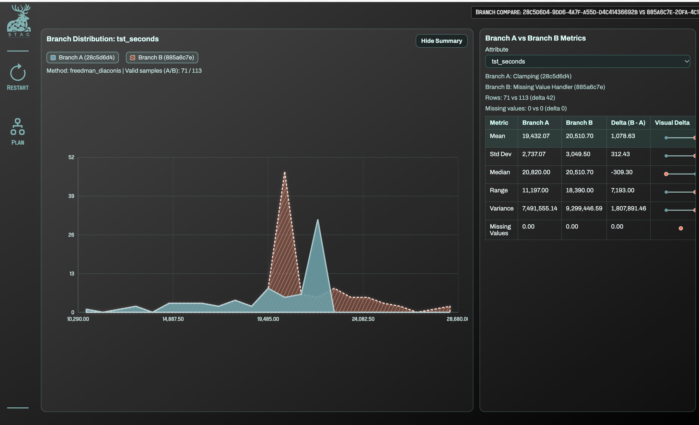
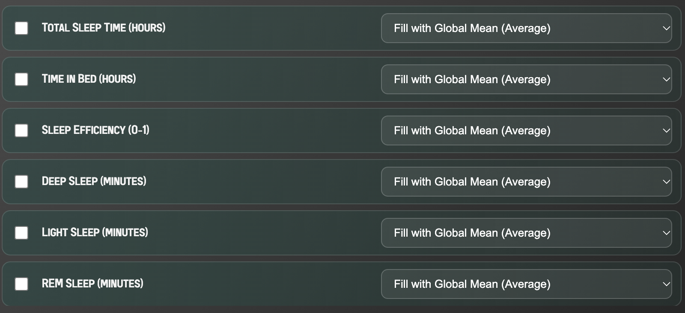
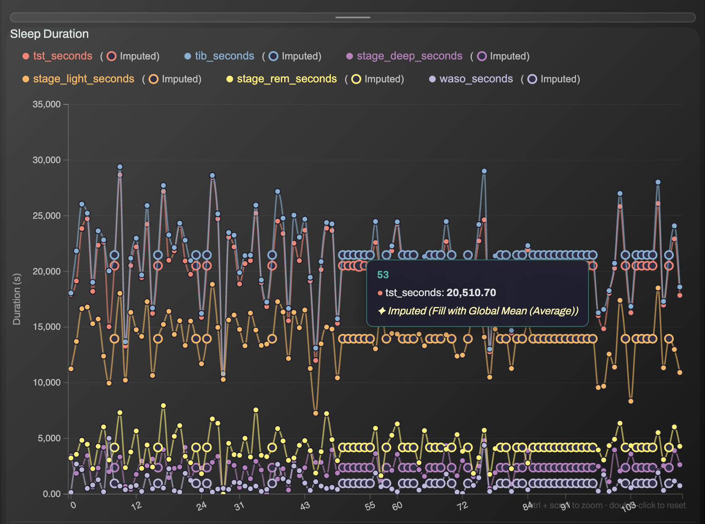
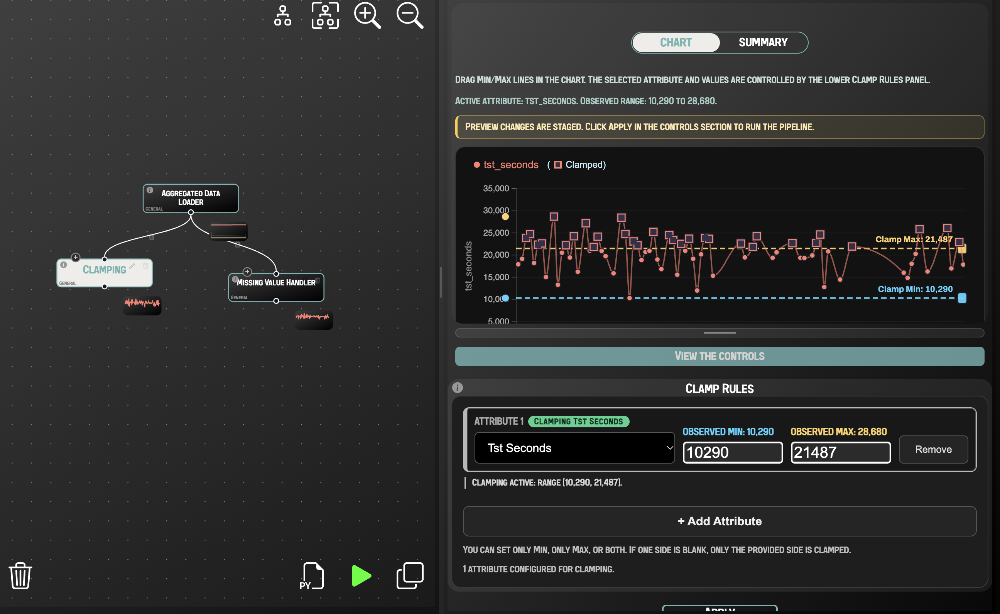
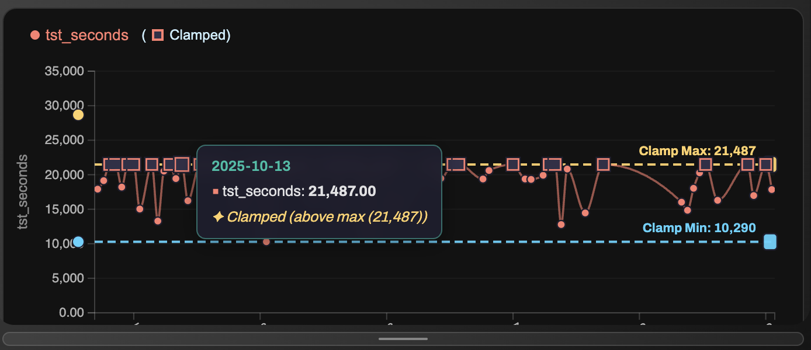
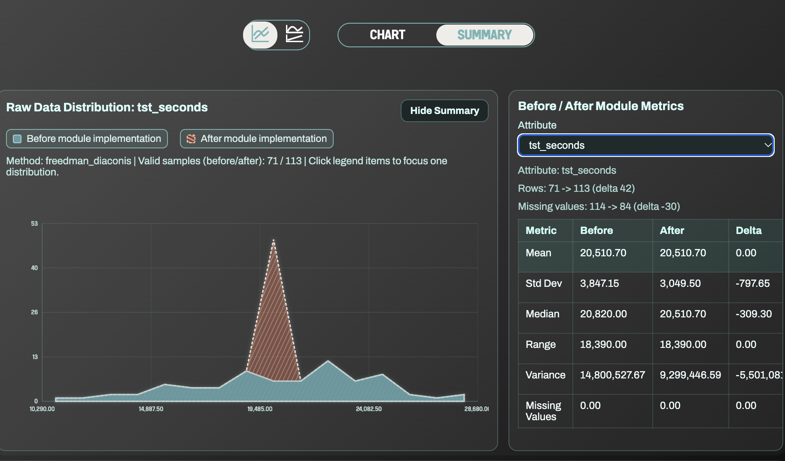
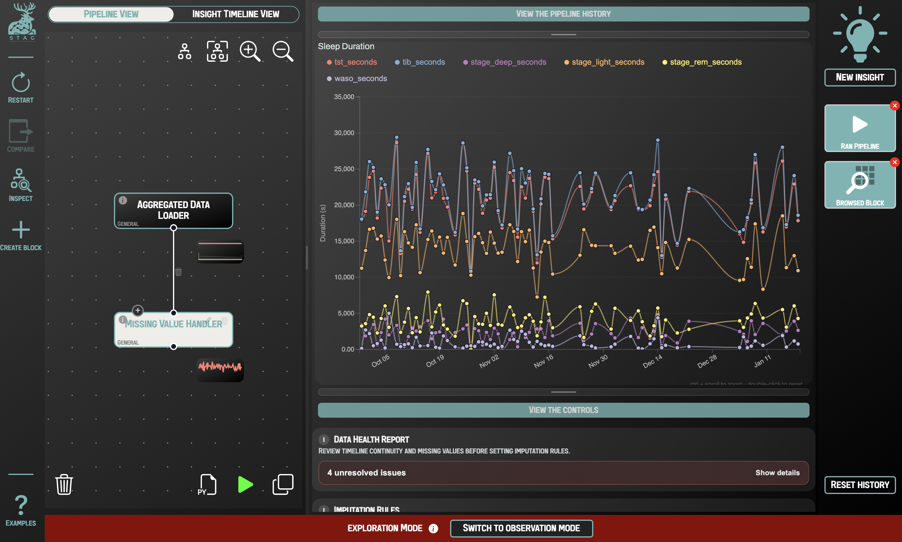
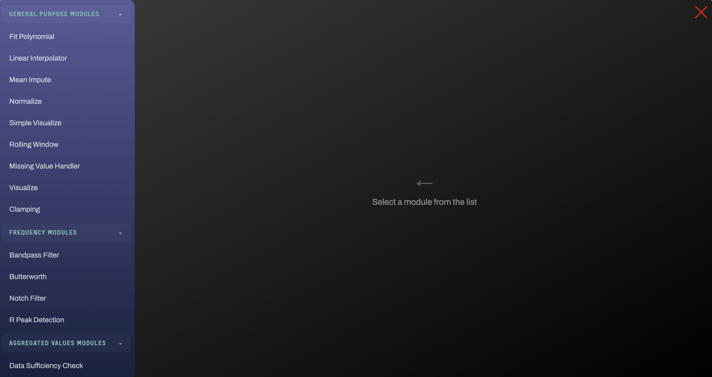

# STAG – Multimodal sleep data pipeline

Master's project at the University of Zurich (Department of Informatics), September 2025 – June 2026.
Team of 4, supervised by Prof. Jürgen Bernard.

> STAG is a University of Zurich project. Its source code belongs to the University of Zurich and is not public. This repository only shows what the project does and what I built, using screenshots and the project report, shared with permission.

## What STAG is

STAG (Statistical Timeseries Analysis Guide) is a visual tool for building data preprocessing pipelines: you connect modules as blocks, run them and see what each step does to the data. It was originally built for high-frequency sensor data such as ECG.

In this project, we extended STAG for sleep research as part of the *STAG Meets Longevity* initiative:

- **Data preparation:** a pipeline that detects which device a raw export comes from and harmonises data from four wearable ecosystems (Garmin, Fitbit, Amazfit and Apple Watch) into one daily dataset, merged with answers from a sleep questionnaire
- **New loader and modules:** support for daily, date-based data, with modules for loading, validating, cleaning, visualising and analysing it, while the existing high-frequency workflow keeps working

The goal is that sleep researchers without a data science background can turn raw wearable exports into clean daily sleep profiles, and see exactly what each processing step changed.

## What I built

### Apple Watch data
I was responsible for the Apple Watch part of the data preparation pipeline:
- Converted Apple Health XML exports into CSV
- Cleaned the data and derived the metrics the export lacks, such as total sleep time from bed and wake times
- Redefined resting heart rate as the night-time minimum, so it means the same thing as on the other devices before the data is combined

### Missing Value Handler
Fills gaps in daily data with a method chosen per variable (for example forward fill, interpolation, mean or median) and can add missing days to the timeline. Filled-in values are marked, so the charts show which values are real and which were imputed.

### Clamping
Limits a variable to a minimum and maximum without deleting rows. The bounds can be set by dragging lines directly in the chart, and every capped value is marked and explained on hover.

### Filter
Filters rows by date, time or numeric conditions.

### Comparison views
Preprocessing choices change results, so I built two full-stack views (Python backend, React frontend) that show exactly what changed:
- **Step summary:** the distribution and key statistics of a variable before and after a module runs
- **Branch comparison:** two alternative pipeline branches side by side, for example clamping versus imputation, compared visually and statistically

All modules are written to work on any date-based dataset, not only sleep data.

## More screenshots

| Pipeline view | Module library |
|---|---|
|  |  |

## Tech stack

Python · pandas · FastAPI · Pydantic · MongoDB · React

## Report

The full project report, describing the design and implementation in detail, is in [report/STAG_Report.pdf](report/STAG_Report.pdf).

## Team

Joao Sacramento, Dominic Häfliger, Yannis Kessler, Alessandro Motta

## Copyright

STAG, its source code, the screenshots and the project report are © University of Zurich and the project team. They are shown here for portfolio purposes only and may not be reused without permission.
